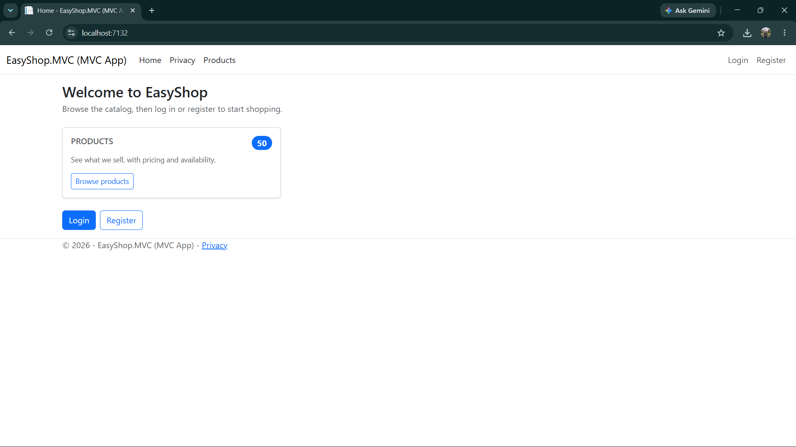
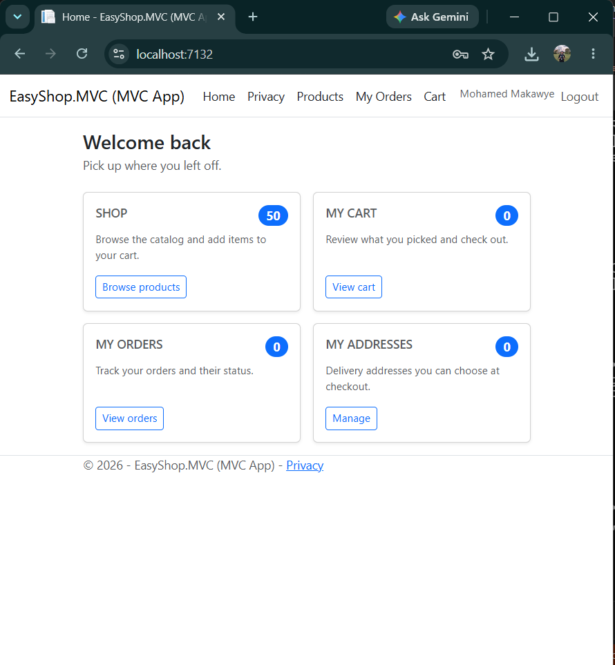
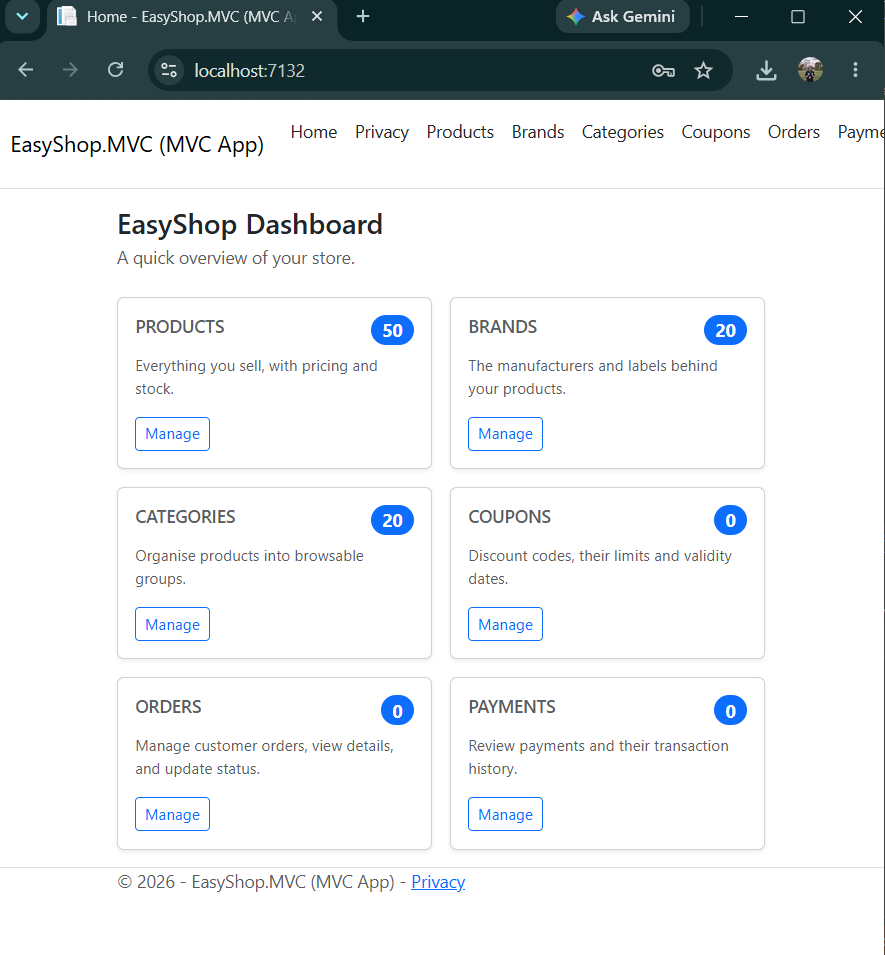
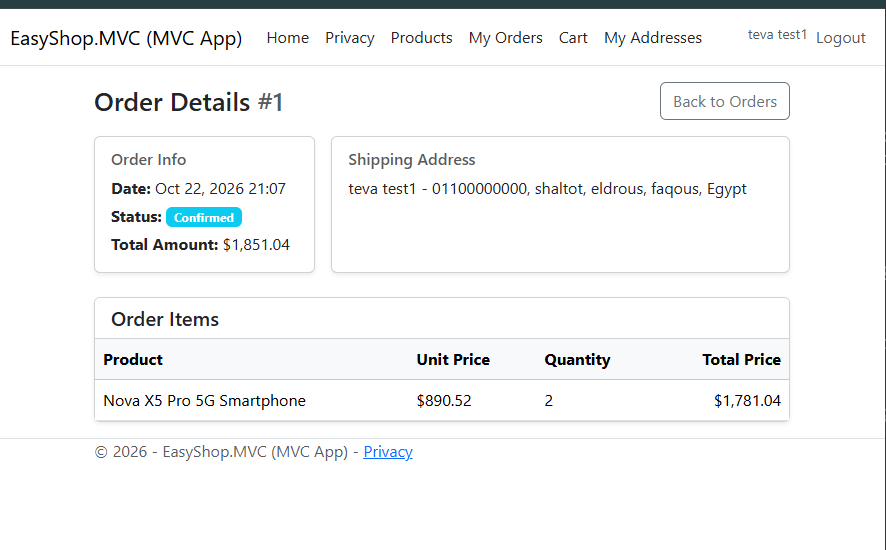
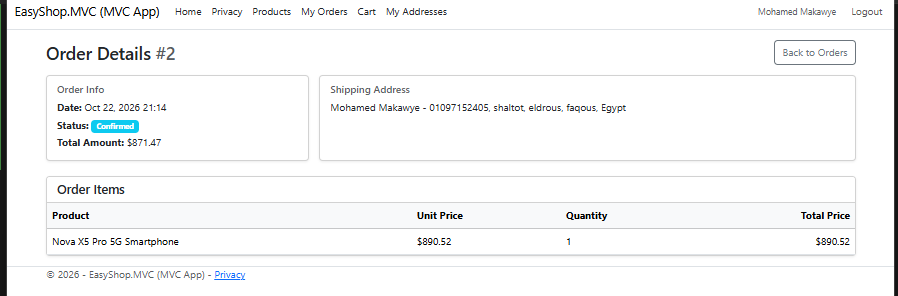
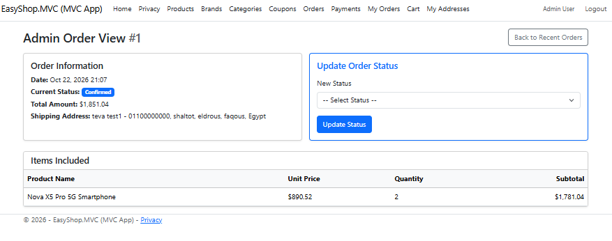

# EasyShop

**Team 4 · Graduation Project**

An online store built on Clean Architecture, from the catalog to the checkout and the admin desk.

Menna Reda · Merna Abdelfattah · Mohamed Tawfik · Abdelrahman Khaled · Nahed Magdy

---

## Contents

1. [What EasyShop is](#what-easyshop-is)
2. [Clean Architecture](#clean-architecture)
3. [Technology stack](#technology-stack)
4. [Data model](#data-model)
5. [Security](#security)
6. [The customer journey](#the-customer-journey)
7. [One home, three views](#one-home-three-views)
8. [An order, end to end](#an-order-end-to-end)
9. [Administration](#administration)
10. [Engineering decisions](#engineering-decisions)
11. [Getting started](#getting-started)
12. [Team 4](#team-4)
13. [What comes next](#what-comes-next)

---

## What EasyShop is

A full e-commerce application where customers browse products, fill a cart and place orders, while administrators manage the catalog, payments and coupons.

| | |
|---|---|
| **27** | domain entities: users, catalog, carts, orders, payments and coupons |
| **5** | architectural layers: Domain, Application, Infrastructure, MVC and API |
| **2** | roles: Customer and Admin, each with its own dashboard |

## Clean Architecture

Dependencies point inward. The business rules know nothing about the database or the web.

```
src/
├── EasyShop.API             Composition root. Wires services, runs migrations and seeds data.
├── EasyShop.MVC             Controllers, Razor views and view models for customers and admins.
├── EasyShop.Infrastructure  EF Core, repositories, unit of work, migrations and password hashing.
├── EasyShop.Application     Services and interfaces. No reference to Entity Framework.
└── EasyShop.Domain          Entities and business concepts. The core, with no dependencies.
```

`Domain` ← `Application` ← `Infrastructure` / `MVC` ← `API`. Data access goes through repository interfaces and a Unit of Work, so the database or the user interface can change without touching the business rules.

## Technology stack

| Technology | Role |
|---|---|
| .NET 10 | C# across every layer of the solution |
| ASP.NET Core MVC | Controllers and Razor views for the whole interface |
| Bootstrap | A responsive layout for customers and admins |
| Entity Framework Core | Code-first model with migrations |
| SQL Server | Relational storage with seeded demo data |
| Cookie authentication | Custom sign-in with claims and roles |

## Data model

Twenty-seven entities in five areas, mapped with one EF Core configuration each.

| Area | Entities |
|---|---|
| **Identity** (4) | User, Role, UserRole, UserAddress |
| **Catalog** (9) | Brand, Category, Product, ProductImage, ProductOption, ProductOptionValue, ProductVariant, ProductVariantOptionValue, InventoryTransaction |
| **Shopping** (5) | Cart, CartItem, WishList, WishListItem, Review |
| **Orders** (5) | Order, OrderItem, OrderShippingAddress, OrderStatusHistory, Shipment |
| **Payments and promotions** (4) | Payment, PaymentTransaction, Coupon, CouponUsage |

A product is separate from its variants, so one product can be sold in several sizes or colours, each with its own price and stock.

## Security

Authentication is custom, and every layer of it was a deliberate choice.

- **Password hashing:** PBKDF2 with SHA-256. Passwords are never stored in plain text.
- **Cookie sessions with claims:** identity, name, email and role travel in the sign-in cookie.
- **Role-based access:** admin screens require the Admin role. The catalog stays public.
- **Request protection:** anti-forgery tokens, rate limiting and open-redirect checks.
- **Secrets:** the connection string and the seeded admin account live in User Secrets, never in the repository.

## The customer journey

From first visit to a confirmed order in six steps.

1. **Register.** Create an account and sign in.
2. **Add an address.** Save where orders are delivered.
3. **Browse.** Active products and their variants.
4. **Fill the cart.** Stock is checked on every add.
5. **Check out.** Pick an address and apply a coupon.
6. **Follow the order.** See items, totals and status.

## One home, three views

The landing page adapts to who is signed in.

| Visitor | Customer | Administrator |
|---|---|---|
|  |  |  |

## An order, end to end

The customer sees the order. The administrator sees the same order.

| Customer: order details | Totals with the coupon discount | Administrator: the same order |
|---|---|---|
|  |  |  |

## Administration

Four areas keep the store running.

- **Catalog.** Products, brands and categories. Removing a product deactivates it and its variants instead of deleting history.
- **Orders.** Every customer order with its items, totals, address and status history.
- **Payments.** Filter by status, open the details, and mark a payment as paid or failed with its transaction recorded.
- **Coupons.** Create and edit discount codes and watch how many times each one has been used.

## Engineering decisions

- **Services, not a second API.** The MVC layer calls the application services directly. One application, one deployment, less to go wrong.
- **One order, one save.** The order, its payment and its shipment are created together, so a failure never leaves a partial order.
- **Deactivate, do not delete.** Removed products become inactive, along with their variants. Customers no longer see them and past orders stay intact.
- **Clear checkout rules.** Flat shipping of 70 EGP, coupon codes normalised, and errors shown on the form instead of a crash page.

## Getting started

### Prerequisites

- .NET 10 SDK
- SQL Server (full, Express or LocalDB)

### 1. Clone

```bash
git clone https://github.com/M3NNa-Reda/EasyShop.git
cd EasyShop
```

### 2. Configure secrets

Secrets are kept out of the repository with [User Secrets](https://learn.microsoft.com/aspnet/core/security/app-secrets). Run these commands from the repository root and adjust the values for your machine:

```bash
dotnet user-secrets set "ConnectionStrings:ConnectionString" "Server=.;Database=EasyShop;Trusted_Connection=True;TrustServerCertificate=True;" --project src/EasyShop.API
dotnet user-secrets set "Seed:AdminEmail" "admin@easyshop.com" --project src/EasyShop.API
dotnet user-secrets set "Seed:AdminPassword" "<choose-a-strong-password>" --project src/EasyShop.API
```

In Visual Studio you can instead right-click **EasyShop.API** and choose **Manage User Secrets**:

```json
{
  "ConnectionStrings": {
    "ConnectionString": "Server=.;Database=EasyShop;Trusted_Connection=True;TrustServerCertificate=True;"
  },
  "Seed": {
    "AdminEmail": "admin@easyshop.com",
    "AdminPassword": "<choose-a-strong-password>"
  }
}
```

### 3. Run

Set **EasyShop.API** as the startup project and press F5, or:

```bash
dotnet run --project src/EasyShop.API
```

On startup the application applies pending migrations, then seeds the catalog, the `Admin` and `Customer` roles and the administrator account from the `Seed` settings, only where the data is missing. Every machine has its own database, so each one needs the secrets above.

### Creating a migration

In the Package Manager Console, with **Default project** set to `EasyShop.Infrastructure` and **EasyShop.API** as the startup project:

```powershell
Add-Migration <MigrationName>
```

### Try it out

1. Register a customer account. A phone number is required because it is used for delivery.
2. Add a delivery address under **My Addresses**.
3. Open a product, choose a variant and click **Add to cart**.
4. From the cart click **Checkout**, choose the address and a payment method, and optionally enter a coupon code.
5. Sign in as the administrator to see the order under **Orders** and the payment under **Payments**, then mark it as paid.

## Team 4

| Menna Reda | Merna Abdelfattah | Mohamed Tawfik | Abdelrahman Khaled | Nahed Magdy |
|---|---|---|---|---|

Built in one shared repository, with every feature developed on its own branch and merged through a pull request.

## What comes next

- **Wishlist and reviews.** The services exist. Screens for customers are next.
- **Online payments.** Connect a payment gateway in place of manual status changes.
- **Product images.** Upload and display pictures across the catalog.
- **Automated tests.** Cover the services with unit and integration tests.
- **Local currency.** Show prices in Egyptian pounds throughout.
- **Web API and mobile.** Expose the same services to other clients if needed.
